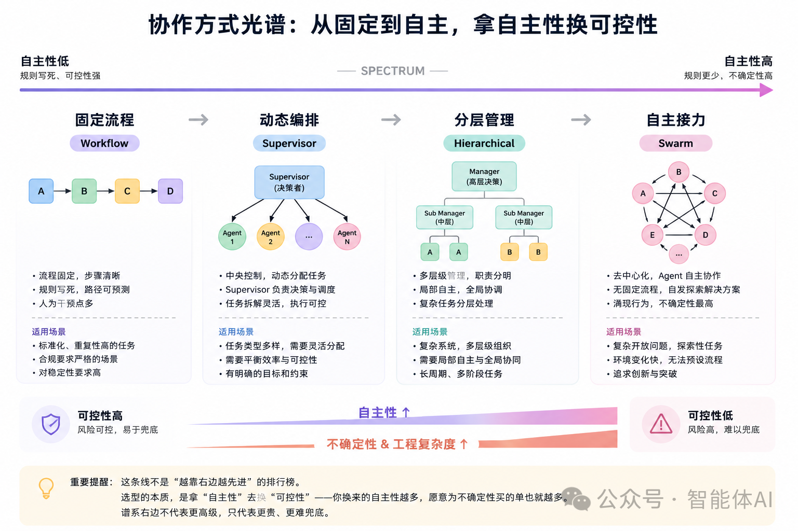
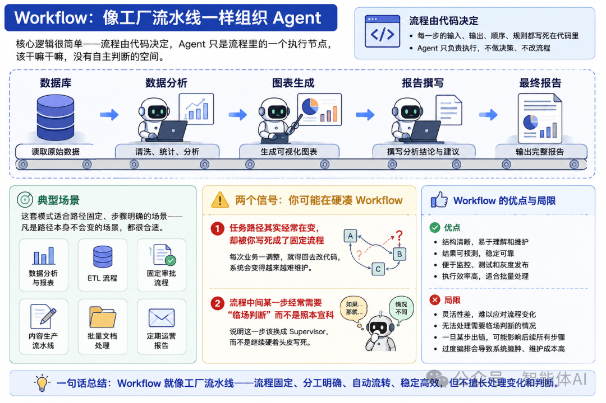
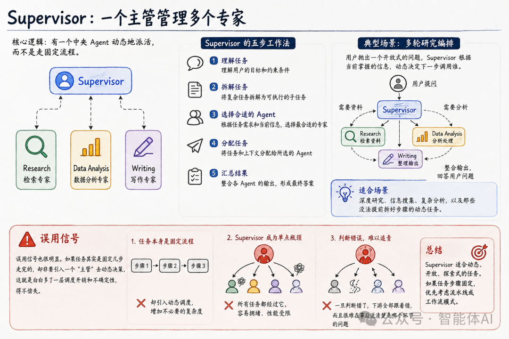
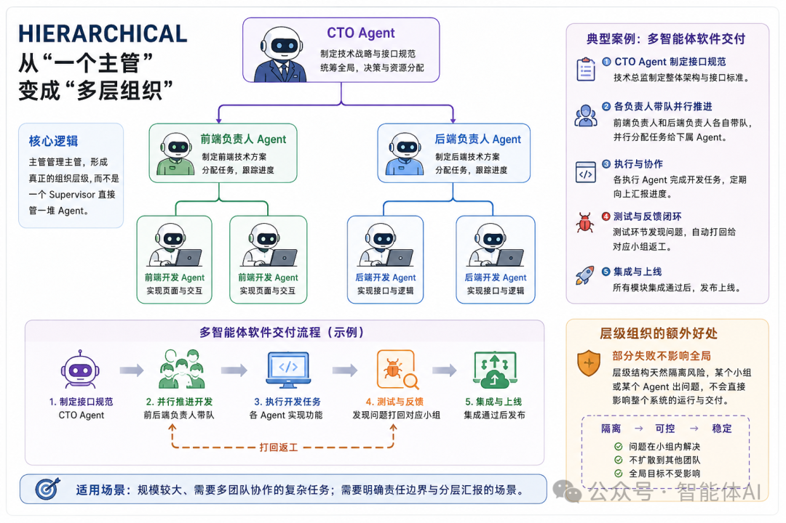
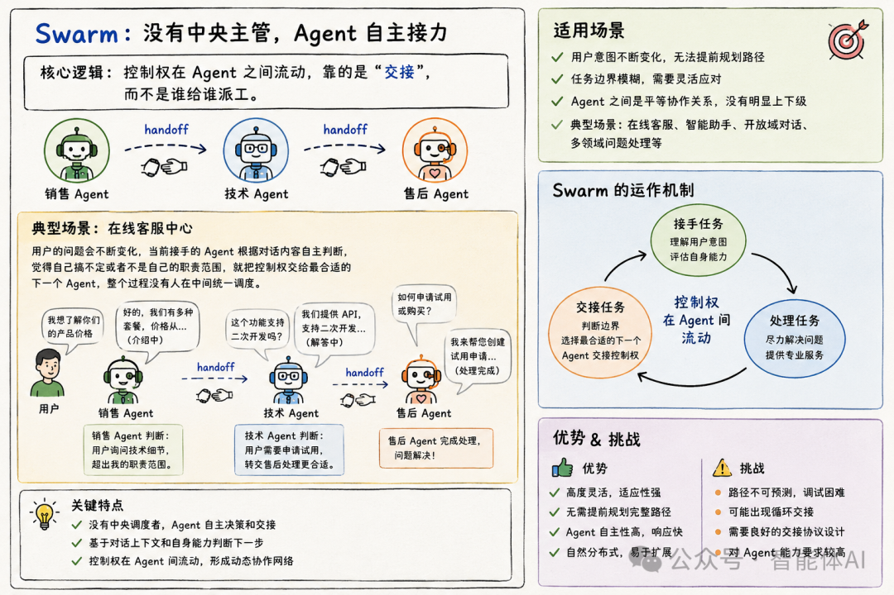

# Multi-Agent 入门指南

> 从 **一个 Agent** 到 **一支 Agent 团队**：理解多智能体系统的协作模式、工程代价与框架选型。

---

## 目录

- [01 从一个 Agent，到一支 Agent 团队](#01-从一个-agent到一支-agent-团队)
- [02 真正要解决的问题：Agent 之间怎么协作？](#02-真正要解决的问题agent-之间怎么协作)
- [03 框架速查](#03-框架速查)

---

## 01 从一个 Agent，到一支 Agent 团队

### 1.1 为什么引入 Multi-Agent

**背景（行业共识）**：过去一年，**"LLM + 工具 + Agent 循环"** 已被公认——一个 Agent 配好工具就能从任务开头做到结尾，几乎无需人工介入。

**问题（单 Agent 的瓶颈）**：任务一旦复杂，单个 Agent 就吃不消了。因为它要同时扮演多个角色——调研、分析、写代码、跑测试、写文案，角色一多麻烦接踵而至。

**真正的思考点**：此时问题的关键已经不是"模型够不够聪明"，而是 **"一个 Agent 到底该不该同时承担这么多事"**——将其拆分为多个专业分工的 Agent 协同工作。

### 1.2 单 Agent 的弊端

- **瓶颈一：工具选择负担过重** —— 工具数量增多后，模型的工具调用决策空间随之扩大，判断准确率反而下降。大量工具描述堆叠于上下文窗口，挤占了有效信息密度，真正对当前任务有用的信息占比持续走低。
- **瓶颈二：上下文信息污染** —— 各子任务的上下文缺乏隔离机制，信息相互渗透。例如测试阶段产生的报错信息可能混入文案撰写的上下文，模型在处理与当前子任务无关的信息时，输出质量随之下降。
- **瓶颈三：多角色行为准则冲突** —— 不同角色遵循的行为准则存在本质矛盾："发散与创意"导向和"严谨与核查"导向无法在同一份系统提示词中兼容共存。模型被迫在相互冲突的指令间反复切换，最终各项任务均无法达到理想执行效果。

### 1.3 Multi-Agent 的好处

将单一 Agent 拆分为多个专职 Agent，可获得三项实质性改进：

- **收益一：并行处理，缩短任务周期** —— 多个子任务可同时并行执行，无需由单个 Agent 按顺序逐个串行处理，整体任务完成效率显著提升。
- **收益二：上下文隔离，消除信息污染** —— 每个 Agent 仅携带与自身子任务相关的信息，上下文窗口不再混入其他任务的数据，从根本上避免"上下文串味"导致的输出质量下降。
- **收益三：角色定制化配置** —— 每个 Agent 可独立配置专属提示词、匹配的工具集，乃至选用更适配其职能的底层模型，使各环节在工具、指令与模型能力三重维度上实现精准优化。

### 1.4 Multi-Agent 随之带来的问题

> 必须正视的是，Multi-Agent 并非只带来收益，其在工程与运行层面存在一系列随之上升的复杂性与代价，这正是许多团队贸然采用后才发现的问题。

- **成本一：Token 消耗显著攀升** —— 多个 Agent 意味着多份上下文与多轮模型调用，推理成本随 Agent 数量及交互轮次直接上升。
- **成本二：调度机制的额外设计代价** —— "下一步由哪个 Agent 执行"属于调度问题，需要专门设计与持续维护，本身即构成一项不可忽视的工程投入。
- **成本三：Agent 间通信的信息保真难题** —— Agent 之间如何传递信息而不产生失真，属于通信问题。信息在多次传递中可能出现语义损耗或偏差，需额外机制加以保障。
- **成本四：故障定位难度急剧增加** —— 出错后需定位是哪个 Agent、哪一环节出现问题。单 Agent 出错仅需复盘一条执行链路；而 Multi-Agent 出错，首先需要厘清责任归属，排查复杂度显著上升。
- **成本五：工程侧整体复杂度全面抬升** —— 工程实现、运行监控与重试逻辑等基础设施的复杂度均随之上升，需投入更多资源加以支撑。

### 1.5 Multi-Agent 是一种全新架构

它不是给 Agent 加了个 buff，而是换了一套完全不同的组织方式，伴随而来的是完全不同的成本结构。

---

## 02 真正要解决的问题：Agent 之间怎么协作？

Multi-Agent 系统真正的核心，是另外三个问题：

- 谁来决定下一步做什么？
- 谁负责把大任务拆成小任务？
- 控制权到底握在谁手里？

### 2.1 自主性谱系

如果把不同的协作方式排成一条线，大致是这样的：

- **一、自主性上升带来的直接收益**：沿谱系向右，系统自主性递增——Agent 可自行作出的判断越多，人为写死的硬性规则越少，系统对复杂任务的适应能力随之增强。
- **二、自主性上升伴随的双重代价**：不确定性显著上升——Agent 自由决策空间扩大，行为结果的可预期性下降；工程复杂度同步抬升——需为更多的自主行为设计兜底、约束与监控机制。
- **三、易被误解之处**：该谱系**不是"越靠右越先进"的排行榜**。选型的本质，是用"自主性"换取"可控性"：获得的自主性越多，愿意为不确定性支付的成本就越高。谱系右侧并不代表更高级，只代表**成本更高、兜底难度更大**。

### 2.2 生产系统很少是一种纯粹的模式

> **真实系统以混合架构为常态，理解模式逻辑远比贴标签重要。**

- **一、纯模式在真实项目中近乎不存在** —— 实际项目中，几乎无人将系统构建为纯粹的单一模式。混合形态才是常态，常见组合包括：Workflow 嵌套 Supervisor、Supervisor 嵌套 Swarm、Hierarchical 中内嵌 Workflow 层。
- **二、实例：混合架构的典型应用** —— 以在线客服系统为例：整体采用 Swarm 式接力，用户问题在不同 Agent 间流转，由最合适者接手；但进入退款流程后，内部处理步骤为写死的固定 Workflow——"退款走哪一步"这类环节绝不会交由 Agent 自行判断。
- **三、核心要义** —— 真正重要的是理解各模式背后的设计逻辑与适用边界，而非为系统贴上"我们采用 Supervisor 架构"的标签。**标签本身无法解决任何工程问题**，实际决策应基于对模式逻辑的理解，针对具体任务需求进行组合设计。

### 2.3 四种主流 Multi-Agent 协作模式

#### 2.3.1 Workflow：像工厂流水线一样组织 Agent（确定性、可控、容易 Debug）

核心逻辑很简单——流程由代码决定，Agent 只是流程里的一个执行节点，该干嘛干嘛，没有自主判断的空间。

> **Workflow 适用于路径固定的场景，路径变动或需临场判断时不应硬套。**

**一、模式的典型运作方式**

以销售数据报表生成为例：每一步的操作内容及完成后的交接对象全部写死在代码中，Agent 仅需在本节点范围内保质完成分配任务，无需也不应具备额外决策。

**二、适用场景界定**

该模式适合路径稳定的任务，具体包括：数据分析、报表生成、ETL 流程、固定审批流程及内容生产流水线。凡业务流程路径本身不发生变化的场景均适用。

**三、误用信号（触发调整的判断依据）**

出现以下两种信号，说明可能在硬套 Workflow：

1. **任务路径频繁变动却仍被写死**：若实际业务路径经常调整却被固定为流程，则每次业务变更都需回改代码，系统可维护性将持续恶化。
2. **流程中存在临场判断需求**：若某一步骤经常需要"临场判断"而非照本宣科，则该环节应切换为 Supervisor 模式，而非继续强行写死。

#### 2.3.2 Supervisor：一个主管管理多个专家（动态规划 + 中央调度）

核心逻辑是，有一个中央 Agent 动态地派活，而不是走固定流程。

**一、核心职能（五步流程）**

Supervisor 的职责可拆解为五个步骤：**理解任务 → 拆解任务 → 选择合适 Agent → 分配任务 → 汇总结果**。

**二、典型运作场景：多轮研究编排**

以多轮研究编排为例：用户抛出开放式问题后，Supervisor 依据当前已掌握的信息，动态决定下一步是调用检索 Agent 搜集资料，还是调用分析 Agent 处理既有数据。该决策无法提前写死，因为后续提问方向不可预知。

**三、适用场景界定**

适用于深度研究、信息搜集、复杂分析，以及无法预先拆解步骤的动态任务。

**四、误用信号（触发调整的判断依据）**

1. **固定任务强行引入主管**：若任务本可按固定步骤完成，却引入 Supervisor 进行动态决策，则白白增加一层调度开销与不确定性，得不偿失。
2. **判断逻辑过度集中于 Supervisor（更隐蔽的隐患）**：当 Supervisor 承担过多判断逻辑时，将演变为事实上的单点瓶颈——一旦其判断失误，下游环节将连锁出错，且事后难以追溯具体问题环节。

#### 2.3.3 Hierarchical：从"一个主管"变成"多层组织"（组织层级 + 上下文隔离 + 责任边界）

核心逻辑是，主管管理主管，形成一个真正的组织层级，而不是一个 Supervisor 直接管一堆 Agent。

**一、典型运作场景：多智能体软件交付**

以软件交付为例：技术总监先制定接口规范；前端负责人与后端负责人各自带队并行推进，再逐层拆解至具体执行 Agent；测试环节发现问题时，自动打回对应小组返工；最终完成集成上线。

**二、适用场景界定**

适用于规模较大、需多团队协作的复杂任务，以及需要明确责任边界与分层汇报机制的场景。

**三、额外价值：部分失败不影响全局（故障隔离）**

层级结构天然起到隔离作用——某个小组中的单个 Agent 出问题时，不会直接拖垮整个系统，失败被限定在局部范围内。

**四、误用信号（触发调整的判断依据）**

1. **过度层级化**：若任务规模不大、单个 Supervisor 即可管理，却硬搭出三层组织架构，则沟通链路随之拉长，反而拖慢速度。这与现实公司管理同理——**并非层级越多越高效**。
2. **层级间接口定义不清**：若层与层之间的接口规范不明确，"返工"等反馈信号在层级间传递时会发生失真，导致上层收到的反馈与下层实际发生的状况对不上。

#### 2.3.4 Swarm：没有中央主管，Agent 自主接力（Handoff + 动态控制权）

核心逻辑跟前面三种都不一样：控制权在 Agent 之间流动，靠的是"交接"，而不是谁给谁派工。

**一、核心机制：无中心调度的控制权流转**

以在线客服为例：用户问题不断变化，当前接手的 Agent 依据对话内容自主判断，若认为自身无法解决或不在职责范围，便将控制权交给最合适的下一个 Agent。全程无人在中间统一调度。

**二、适用场景界定**

适用于用户意图不断变化、无法提前规划路径的场景；以及 Agent 间本就平等协作、无明显上下级关系的场景。

**三、误用信号（触发调整的判断依据）**

1. **需审计决策的业务误用 Swarm（高度警示）**：若业务流程要求审计每一步决策——例如涉及金钱、合规等事项——却选择了控制权自由流转的 Swarm 模式，则出问题后难以说清"谁在何时做了什么决定"。这在诸多行业中属不可接受的缺陷。**此信号直接呼应"别急着上 Multi-Agent"的基调。**
2. **交接逻辑设计不清，导致踢皮球**：若 Agent 间交接规则不明确，易出现"来回踢皮球"：Agent A 将问题交予 B，B 认为不属己责又退回 A，用户在反复转手中被消耗。

---

> **结论**：Swarm 的价值在于应对意图高度动态、协作平等的场景，但其**决策轨迹不可追溯**与**交接机制依赖良好设计**的双重特性，决定了它不适用于需严格审计或边界模糊的业务，选择前须充分评估这两项约束。

#### 2.3.5 总结

| 模式 | 决策方 | 自主性 | 可控性 | 典型场景 |
| :--- | :--- | :---: | :---: | :--- |
| Workflow | 代码 | 低 | 高 | 报表、ETL、固定审批 |
| Supervisor | 中央 Agent | 中 | 中高 | 深度研究、动态拆分 |
| Hierarchical | 多层 Agent | 中高 | 中 | 大规模团队协作 |
| Swarm | Agent 之间 | 高 | 低 | 客服、意图多变场景 |

---

## 03 框架速查

| 框架 | Workflow | Supervisor | Hierarchical | Swarm/Handoff | 核心特色 |
| :--- | :---: | :---: | :---: | :---: | :--- |
| LangGraph | ★★★★★★ | ★★★★★★ | ★★★★★★ | ★★★★ | Graph + State |
| OpenAI Agents SDK | ★★★★★ | ★★★★★★ | ★★★★★ | ★★★★★★ | 极简原语 + Handoff |
| Claude Agent SDK | ★★★★ | ★★★★★ | ★★★★★ | ★★★ | Claude 生态 + Subagents |
| CrewAI | ★★★★★★ | ★★★★★ | ★★★ | ★★★ | Role / Crew |
| Microsoft Agent Framework | ★★★★★★ | ★★★★★★ | ★★★★★★ | ★★★★ | Agent + Workflow |
| AgentScope | ★★★★★ | ★★★★★ | ★★★★★ | ★★★★★ | Multi-Agent 原生协作 |
| AutoGen | ★★★★★ | ★★★★★ | ★★★★ | ★★★★ | 历史影响力，非新项目首选 |
